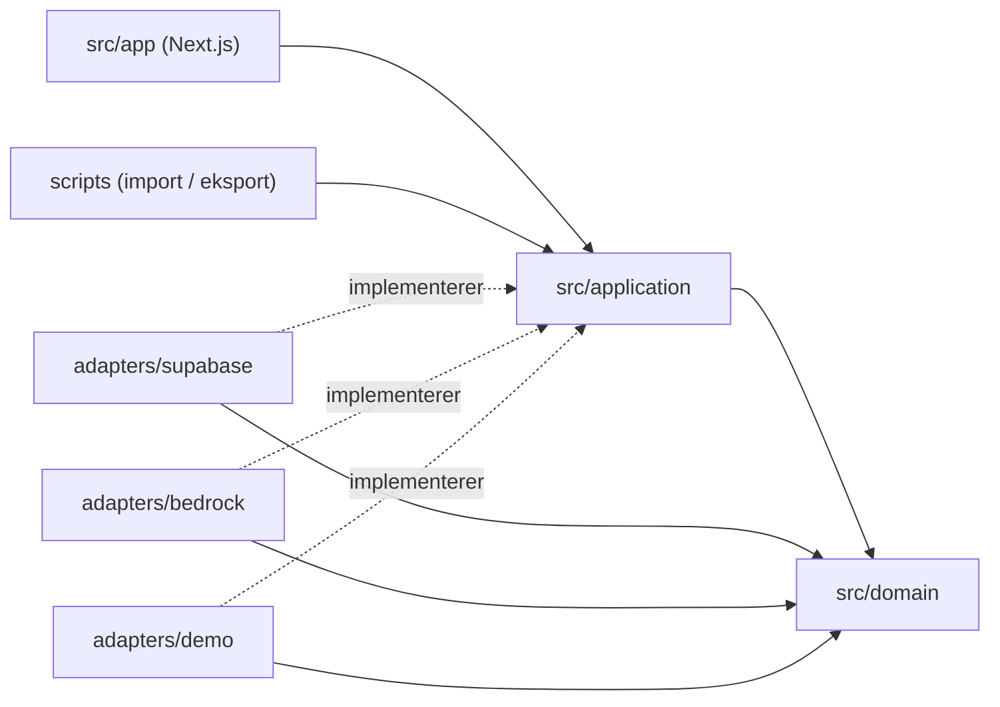
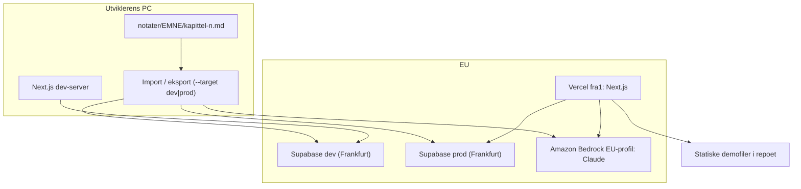
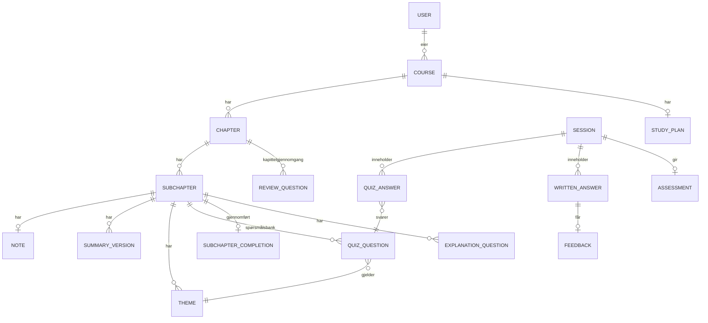

# Architecture Spine: Studievenn

## Design Paradigm

**Ports and adapters (heksagonal arkitektur).** Kjernen (domene og applikasjon) kjenner bare grensesnitt («porter»). Database, KI, demodata, klokke og importkommandoen er utskiftbare adaptere. Next.js-ruter og skjermer kaller bare applikasjonslaget.

| Lag | Mappe | Inneholder |
| --- | --- | --- |
| Domene | `src/domain/` | Rene regler: 80 %-avkrysning, planformelen, nytt spørsmål om samme tema, størrelsen på dagens forslag, når kapittelgjennomgangen åpnes, `hasNotes`, tolking av kapittellister og gjennomgangsspørsmål |
| Applikasjon | `src/application/` | Brukstilfeller (for eksempel `finishQuiz`, `startPlan`, `endSession`, `importChapter`) og portene `DataSource`, `AiProvider`, `Clock`. Skjema for demofilene |
| Adaptere | `src/adapters/` | `supabase/`, `bedrock/`, `demo/` (statiske filer og minne), `clock/` |
| Inngangspunkter | `src/app/` (Next.js), `scripts/` | Skjermer og ruter, importkommandoen og eksportkommandoen for demodata |



## Invariants & Rules

### AD-1: Ports and adapters er grunnmønsteret [ADOPTED]

- **Binds:** all
- **Prevents:** at database- eller KI-kall sprer seg inn i regler og skjermer, slik at demoen og testene ikke kan kjøre uten database.
- **Rule:** Avhengigheter går bare innover, som i diagrammet over. `src/domain` importerer ingenting fra `src/application`, `src/adapters` eller `src/app`, og ingen rammeverk-, database- eller KI-pakker. `src/app` og `scripts` importerer aldri fra `src/adapters` direkte. Adaptere velges på ett sted (én komposisjonsrot per inngangspunkt). `src/domain` og `src/application` bruker ingen serverkode (Node-API-er, `server-only`, miljøvariabler), slik at de også kan kjøre i nettleseren (AD-3).

### AD-2: Kjernereglene ligger bare i domenemodulen [ADOPTED]

- **Binds:** FR-4, FR-8, FR-9, FR-10, FR-14, FR-15, FR-27, FR-28, NFR-8
- **Prevents:** at reglene dupliseres i skjermer og API og ikke kan testes, og at plassholdertekst regnes som notater.
- **Rule:** 80 %-grensen, planformelen (planlagt i dag, etterslep), utvalg av nytt spørsmål om samme tema, størrelsen på dagens forslag, når kapittelgjennomgangen åpnes, og tolkingen av kapittellister og gjennomgangsspørsmål finnes bare i `src/domain` som rene funksjoner. Tolkingen er deterministisk og bruker ikke KI. Om et delkapittel har notater, avgjøres bare av `hasNotes(noteText)`: tom tekst, bare mellomrom og plassholderen `*Ingen notater ennå.*` betyr ingen notater. Importen, statusen «mangler notater» (FR-8) og planformelen (FR-9) bruker alle denne funksjonen. Hver regel har automatiske tester.

### AD-3: Demoen bruker samme skjermer og regler, men en egen datakilde [ADOPTED]

- **Binds:** FR-26, NFR-5
- **Prevents:** en egen demo-kodebase som glir fra appen, og at demoen ser eller endrer eierens data.
- **Rule:** Demoen kjører de samme brukstilfellene i nettleseren med `DemoDataSource` (frosne filer pluss tilstand i minnet, speilet til `sessionStorage`) og en `DemoClock` med fast dato. Den gjør aldri KI-kall og rører aldri databasen. Demofilene følger ett skjema i `src/application`, som både `scripts/export-demo.ts` og demo-adapteren validerer mot. Demodata lages bare med eksportkommandoen (kapittel 1–3: sammendrag, spørsmålsbanker, gjennomgangsspørsmål med faste eksempeltilbakemeldinger og planinndata).

### AD-4: Notater kommer inn via en lokal importkommando, som også lager KI-innholdet [ADOPTED]

- **Binds:** FR-8, FR-11, FR-13, FR-27, NFR-3, NFR-6
- **Prevents:** at notater og KI-innhold havner i databasen på flere måter som ikke stemmer overens, at KI-kostnader oppstår uten kontroll, og at én rettelse regenererer et helt kapittel.
- **Rule:** Kilden er `notater/<EMNE>/kapittel-<n>.md`. Importkommandoen kjøres eksplisitt (ikke ved deploy) og er idempotent. Endringer oppdages per artefakt med `inputHash = hash(normalisert delkapittelnotat + kapittelets læringsmål og nøkkelbegreper + promptversjon)`. Seksjonene `## Råtekst` og `## Rettelser` er aldri med i hashen eller i KI-input. For artefakter med ny hash lager importen sammendrag, spørsmålsbank og forklaringsspørsmål gjennom KI-modulen (AD-7) før den skriver til databasen. Den fyller også på banker med færre enn 10 ubesvarte spørsmål og lager erstatninger for feilrapportert innhold (AD-18). `--force <n.m>` tvinger fram ny generering.

### AD-5: Kapitler og delkapitler identifiseres ved nummer, ikke tittel [ADOPTED]

- **Binds:** FR-3, FR-4, FR-5, FR-8, FR-15, FR-20
- **Prevents:** dupliserte delkapitler og tapt framdrift ved ny import.
- **Rule:** Et kapittel identifiseres av (eier, emnekode, kapittelnummer), og et delkapittel av (eier, emnekode, delkapittelnummer, for eksempel «1.1»). Titler er attributter som kan endres. Nytt nummer betyr ny enhet, og framdrift følger ikke med.

### AD-6: Spørsmål slettes aldri, og brukerens fasit er autoritativ [ADOPTED]

- **Binds:** FR-13, FR-14, FR-16, FR-21, FR-27, FR-28
- **Prevents:** svarforsøk som peker på spørsmål som ikke finnes, quizer som mister spørsmål underveis, og at KI «retter» brukerens fasit.
- **Rule:** Quiz- og gjennomgangsspørsmål har stabil ID, trekkes tilbake med status og slettes aldri. Et spørsmål regnes som *brukt* når det er valgt til en quiz. Når notater endres, trekkes bare *ubrukte, KI-genererte* spørsmål tilbake. En quiz som er i gang, fullføres alltid med spørsmålene den startet med, og bare en feilrapport (FR-16) kan ta ut ett av dem underveis. Spørsmål brukeren har skrevet selv (fra `## Spørsmålsbank` i notatfilen), erstattes aldri automatisk. Brukerens fasit er alltid riktig alternativ, og KI lager bare tre gale alternativer, en kort forklaring og et tema (AD-14).

### AD-7: Alle KI-kall går gjennom én KI-modul [ADOPTED]

- **Binds:** FR-5, FR-11, FR-13, FR-17, FR-18, FR-19, FR-21, NFR-2, NFR-4, NFR-6
- **Prevents:** KI-kall spredt rundt i koden, ugyldig KI-innhold i databasen, KI-kall utenfor EU, og innhold der man ikke vet hvordan det ble laget.
- **Rule:** KI-modulen implementerer porten `AiProvider` med `AnthropicBedrock` (standardendepunktet `bedrock-runtime`) i `eu-central-1`. Prompter ligger i versjonerte filer. Hvert svar valideres mot et fast skjema før det lagres (for eksempel har et flervalgsspørsmål nøyaktig fire alternativer og ett riktig). Hvert lagret KI-resultat lagrer modell-ID og promptversjon. Modell og effort for hver oppgave står i én innstillingsfil i modulen og ingen andre steder, og effort settes alltid eksplisitt (lav eller middels som start): Opus 5.5 for tilbakemelding (FR-19), Sonnet 5.5 for sammendrag, spørsmålsbank, forklaringsspørsmål og vurdering, Haiku 5.5 for oversetting av titler. Modell-ID-ene er EU-profiler (`eu.anthropic.claude-…`). En automatisk test feiler hvis en ID starter med noe annet enn `eu.`, for eksempel `global.` eller `us.`. Kapittelets læringsmål og nøkkelbegreper sendes med som kontekst, sammen med emnets læringsutbytte.

### AD-8: Innhold har versjoner, og bare klart innhold kan foreslås [ADOPTED]

- **Binds:** FR-8, FR-10, FR-11, FR-12, FR-13, NFR-3
- **Prevents:** at kveldsøkta stopper fordi et delkapittel mangler sammendrag eller spørsmål, og at en feilet ny generering tar bort innhold som virket.
- **Rule:** Sammendrag og spørsmålsbank har versjoner med statusen `lages`, `klart` eller `feilet`. Et delkapittel er klart når det finnes en klar versjon av begge, og appen viser den siste klare versjonen. En feilet ny generering registreres på den nye versjonen og tar aldri bort en klar versjon. Dagens forslag (FR-10) velger aldri et delkapittel som ikke er klart.

### AD-9: Supabase-innlogging fra dag én er tilgangslåsen [ADOPTED]

- **Binds:** FR-1, FR-2, FR-25, NFR-5
- **Prevents:** at det bygges en midlertidig lås som må kastes, og to ulike måter å identifisere eieren på.
- **Rule:** Supabase Auth brukes fra første versjon, med bare eierens konto og offentlig registrering slått av. FR-1 legger til kontofunksjonene (innlogging, tilbakestilling av passord), men registrering forblir av til det er bestemt å åpne appen for andre (PRD §9.2). Det finnes ingen egen passordmekanisme. Uinnloggede besøkende kommer bare til demoen.

### AD-10: Hver bruker ser bare sine egne data, sikret i databasen [ADOPTED]

- **Binds:** NFR-5, FR-1, FR-2
- **Prevents:** at én feil i appkoden lekker en annen brukers data, at sletting av konto etterlater data, og at skjemaet i dev og prod glir fra hverandre.
- **Rule:** Alle tabeller med brukerdata har en eier-kolonne med fremmednøkkel til `auth.users` og `on delete cascade`, og row level security som bare slipper gjennom eierens rader. Appen sjekker i tillegg eierskap. Skjema, RLS og tilganger (`GRANT`) endres bare med migreringer i `supabase/migrations/` via Supabase CLI. De kjøres mot `dev` først og så mot `prod`, aldri via dashbordet. Hver migrering som lager en tabell, har med både RLS-regler og `GRANT`.

### AD-11: All datologikk regnes i norsk tid [ADOPTED]

- **Binds:** FR-9, FR-10, FR-20, FR-22, FR-23
- **Prevents:** at «i dag», studiedager og etterslep blir feil rundt midnatt fordi server og nettleser har ulik tidssone.
- **Rule:** «I dag», studiedager (mandag–fredag), helger og planformelen (*d*, *D*) regnes i Europe/Oslo via porten `Clock`. Kalenderdatoer lagres som rene datoer, og tidspunkter lagres som UTC.

### AD-12: Data og KI holdes i EU, og miljøene holdes atskilt [ADOPTED]

- **Binds:** NFR-4, NFR-7
- **Prevents:** at data eller KI-kall havner utenfor EU/EØS, og at lokal utvikling eller tester skriver til ekte data.
- **Rule:** Supabase-prosjektene `dev` og `prod` ligger i eu-central-1 (Frankfurt). `vercel.json` setter `"regions": ["fra1"]`. Appen bruker ikke Next.js-middleware, fordi Vercel kjører middleware i alle regioner. Innloggingsøkta fornyes i serverkode. Claude kalles bare via Bedrocks EU-profil, som kan behandle forespørsler i flere EU-regioner. Dev-serveren og testene bruker bare `dev` (`.env.local`). Import og eksport krever `--target dev|prod` og leser `.env.dev.local` eller `.env.prod.local`, og ved `prod` må brukeren bekrefte. Eieren finnes ved oppslag på e-post (`OWNER_EMAIL`) i målprosjektet. `export-demo` leser alltid fra `prod`. Forhåndsvisninger i Vercel bruker `dev`, og bare `main` kjører mot `prod`.

### AD-13: «Gjennomført» skrives én gang, av `finishQuiz`

- **Binds:** FR-9, FR-15, FR-16, FR-20, FR-28
- **Prevents:** at framdriftsindikatoren, kapittellisten og planen regner ut «gjennomført» hver for seg og viser ulike tall.
- **Rule:** Bare brukstilfellet `finishQuiz` skriver `subchapter_completion` (tidspunkt og quiz-ID), én gang per delkapittel. Den angres aldri av senere quizer, feilrapporter eller ny import. Quizresultatet fryses når quizen avsluttes. Alle andre leser «gjennomført» fra denne posten og regner det ikke ut på nytt.

### AD-14: Temaer er egne enheter per delkapittel

- **Binds:** FR-13, FR-14, FR-16, FR-21
- **Prevents:** at samme tema får litt ulike navn i ulike KI-kjøringer, slik at «nytt spørsmål om samme tema» og «svakt tema» slutter å virke.
- **Rule:** Temaer opprettes bare når hele spørsmålsbanken for et delkapittel lages. Påfylling og erstatning av spørsmål får den eksisterende temalisten med i prompten, og skjemaet godtar bare temaer fra listen.

### AD-15: Planen lagres som et øyeblikksbilde, og dagens forslag ligger fast gjennom dagen

- **Binds:** FR-9, FR-10, FR-20
- **Prevents:** at to skjermer regner planen fra ulike utgangspunkt, og at «I kveld: 3.2» blir til 3.3 midt i økta.
- **Rule:** Bare `startPlan` skriver G₀, R₀ og D, og bare når eksamensdato eller planstart lagres. G₀ telles fra gjennomføringer før planstart. Dagens forslag regnes ut fra tilstanden ved starten av dagen i Europe/Oslo og endres ikke før midnatt.

### AD-16: Økta avsluttes av `endSession`, som lager én vurdering

- **Binds:** FR-17, FR-18, FR-19, FR-21, FR-28
- **Prevents:** to vurderinger samme kveld eller ingen, og fritekstsvar uten fast plass.
- **Rule:** Hver økt er en `session`. Alle svar (quizsvar og skrevne svar på forklarings- og gjennomgangsspørsmål) er knyttet til en økt. Bare `endSession` avslutter økta og ber om én vurdering (FR-21) per avsluttet økt.

### AD-17: Notatfilene eier kapittelstrukturen og gjennomgangsspørsmålene [ADOPTED]

- **Binds:** FR-3, FR-4, FR-5, FR-8, FR-27, FR-28
- **Prevents:** at appen og importen begge oppretter delkapitler, slik at titler overskrives eller et skrivefeil-nummer gir et ekstra delkapittel, og at gjennomgangsspørsmål har to kilder.
- **Rule:** For emner med notatfiler oppretter og oppdaterer bare importen kapitler og delkapitler, ut fra `### n.m Tittel` i `kapittel-<n>.md`. Importen validerer hele filen før den skriver noe: hvert delkapittelnummer må starte med filens kapittelnummer, og ingen nummer kan stå to ganger. Er noe feil, stopper den uten å skrive. Gjennomgangsspørsmål kommer bare fra `## Gjennomgangsspørsmål` i samme fil. Mangler seksjonen, lar importen eksisterende spørsmål være i fred. Et spørsmål gjenkjennes på normalisert tekst, og endret tekst gir et nytt spørsmål mens det gamle trekkes tilbake (AD-6). Innliming i appen (FR-4, FR-5, FR-27) er bare for emner uten notatfiler og skriver aldri til et emne som har dem.

### AD-18: Bare tilbakemelding og vurdering kaller KI mens appen er i bruk [ADOPTED]

- **Binds:** FR-12, FR-13, FR-16, FR-17, FR-18, FR-19, FR-21
- **Prevents:** at spørsmålsbanken får to skrivere (importen og appen), og at KI-kall fra appen mangler kapittelkonteksten importen har.
- **Rule:** Bare tilbakemelding på skrevne svar (FR-19) og vurdering (FR-21) kalles synkront fra serverkode på Vercel, gjennom `AiProvider`. Feiler kallet, lagres svaret, brukeren får beskjed og kan prøve igjen, og quizen stopper aldri. Alt annet KI-innhold (sammendrag, spørsmålsbank, påfylling, erstatninger og forklaringsspørsmål) lages bare av importen. En feilrapport (FR-12, FR-16) merker eller trekker tilbake innholdet med en gang, og importen lager erstatningen neste gang den kjøres.

## Consistency Conventions

| Concern | Convention |
| --- | --- |
| Eierskap | Hver entitet har ett brukstilfelle som skriver den. Andre leser den gjennom `DataSource` og regner ikke ut avledet tilstand selv. Struktur, notat, gjennomgangsspørsmål og KI-innhold → importen (AD-17, AD-18), gjennomført → `finishQuiz`, plan → `startPlan`, vurdering → `endSession` |
| Navn i kode | Engelsk for tabeller, funksjoner, filer og ruter. Fast ordliste: emne=course, kapittel=chapter, delkapittel=subchapter, notat=note, sammendrag=summary, spørsmålsbank=questionBank, quizspørsmål=quizQuestion, tema=theme, gjennomgangsspørsmål=reviewQuestion, kapittelgjennomgang=chapterReview, forklaringsspørsmål=explanationQuestion, tilbakemelding=feedback, vurdering=assessment, studieplan=studyPlan, etterslep=backlog, dagens forslag=dailySuggestion, økt=session |
| Språk | Grensesnitt, prompter, KI-innhold, commit-meldinger og dokumentasjon på norsk bokmål |
| Datoer | Rene datoer for kalenderdager, UTC for tidspunkter, Europe/Oslo for all datologikk (AD-11) |
| Feil fra KI | Lagres som status `feilet` på en ny versjon (AD-7, AD-8), aldri som et halvferdig resultat |
| Hemmeligheter | `.env.local` (dev-server), `.env.dev.local` og `.env.prod.local` (scripts), Vercel-miljøvariabler. Gjelder Supabase- og AWS-nøkler. `.env.example` lister navnene uten verdier |
| Tester og CI | Domeneregler har enhetstester med Vitest (NFR-8). GitHub Actions kjører typesjekk, lint og domenetester ved hver push. Adaptere testes mot `dev`, aldri mot `prod` |
| Sikkerhetskopi | Ukentlig `supabase db dump` av `prod` til en mappe som er i `.gitignore` (gratisnivået har ingen sikkerhetskopi) |
| Commits | Små, med beskrivende norske meldinger, slik at veien fra plan til kode er sporbar (IBE160) |

## Stack

| Name | Version |
| --- | --- |
| Next.js (fullstack: UI + serverkode, TypeScript) | 16.4 (minst 16.4.1, sikkerhetsoppdatering) |
| Supabase (Postgres + Auth), region eu-central-1 (Frankfurt) | hosted, gratisnivå; to prosjekter: dev og prod |
| Supabase JS-klient (`@supabase/supabase-js`) og Supabase CLI | låses ved installasjon |
| Vercel (hosting), funksjonsregion `fra1` | Hobby |
| Vitest (enhetstester) og GitHub Actions (CI) | låses ved installasjon |
| KI: Claude via Amazon Bedrock, EU-profil fra eu-central-1 | per oppgave, se under |
| Claude Opus 5.5: tilbakemelding på forklaringssvar (FR-19) | `eu.anthropic.claude-opus-5-5` |
| Claude Sonnet 5.5: sammendrag, spørsmålsbank, forklaringsspørsmål, vurdering (FR-11, 13, 17, 18, 21) | `eu.anthropic.claude-sonnet-5-5` |
| Claude Haiku 5.5: oversetting av titler (FR-5) | `eu.anthropic.claude-haiku-5-5` |
| Bedrock-klient (`@anthropic-ai/bedrock-sdk`, `AnthropicBedrock`) | låses ved installasjon |

## Structural Seed

**Driftsmiljø**



**Kjerneentiteter** (navn og koblinger, ikke kolonner)



**Kildetre**

```text
src/
  domain/        # rene regler + tester (AD-2)
  application/   # brukstilfeller, porter, skjema for demofiler
  adapters/
    supabase/    # DataSource mot Postgres, RLS (AD-10)
    bedrock/     # AiProvider, prompter, skjemaer, modellfordeling (AD-7)
    demo/        # DataSource mot statiske filer og minne (AD-3)
    clock/       # Europe/Oslo og DemoClock (AD-11)
  app/           # Next.js-skjermer og ruter
scripts/
  import.ts      # notater -> KI -> database (AD-4)
  export-demo.ts # database -> demofiler (AD-3)
supabase/
  migrations/    # skjema, RLS og GRANT (AD-10)
demo-data/       # frosne demofiler
notater/         # kildenotater per emne og kapittel
```

## Capability → Architecture Map

| Capability / Area | Lives in | Governed by |
| --- | --- | --- |
| FR-1, FR-2, FR-25: innlogging, sletting, tilgangslås | Supabase Auth, `adapters/supabase` | AD-9, AD-10 |
| FR-3, FR-6: emner, læringsutbytte | `application`, `adapters/supabase` | AD-5, AD-10 |
| FR-4, FR-5 [Bør]: innliming og oversetting for emner uten notatfiler | `domain` (tolking), `adapters/bedrock` (oversetting) | AD-2, AD-7, AD-17 |
| FR-8, FR-11, FR-12, FR-13: import av struktur og notater, sammendrag, feilrapport, spørsmålsbank | `scripts/import.ts`, `adapters/bedrock` | AD-4, AD-6, AD-7, AD-8, AD-14, AD-17, AD-18 |
| FR-9, FR-10, FR-20: studieplan, dagens forslag, framdrift | `domain`, `application` | AD-2, AD-8, AD-11, AD-13, AD-15 |
| FR-14–FR-16: quiz, avkrysning, feilrapport | `domain`, `application` | AD-2, AD-6, AD-13, AD-14, AD-18 |
| FR-17, FR-18: forklaringsspørsmål (laget i importen) | `scripts/import.ts`, `application` | AD-7, AD-18 |
| FR-19, FR-21: tilbakemelding og vurdering (synkron KI) | `application`, `adapters/bedrock` | AD-7, AD-16, AD-18 |
| FR-26: demo | `adapters/demo`, `scripts/export-demo.ts` | AD-3 |
| FR-27, FR-28: gjennomgangsspørsmål og kapittelgjennomgang | `scripts/import.ts`, `domain` (tolking, åpning), `application` | AD-2, AD-6, AD-16, AD-17 |
| NFR-4, NFR-7: EU og drift | Supabase, Vercel, Bedrock | AD-12 |

## Åpne spørsmål

1. **Bedrock-pris i EU-profilen:** sjekkes på AWS sin prisside før første KI-kode.
2. **AWS sine vilkår om trening på data:** bekreftes i AWS sin egen dokumentasjon og lenkes i IBE160-dokumentasjonen.

## Deferred

- **Push-varsler (FR-22, FR-23):** [Bør] i PRD-en. Avgjøres når del 3 er i rute. Tidsstyring skal da kjøre i Supabase (`pg_cron` og serverfunksjon) med Web Push, og appen må kunne legges til på hjemskjermen (PWA). Vercel Hobby tillater bare to daglige cron-jobber.
- **Bakgrunnsjobb for KI-generering:** trengs først når notater kan limes inn i appen (FR-8 for andre emner). Til da kjører genereringen i importkommandoen (AD-4).
- **Henting fra himolde.no (FR-7)** og **tale (FR-24):** [Bør] og strekkmål, så de designes ikke nå.
- **Kolonner i databaseskjemaet:** Koden eier detaljene. Entitetene, nøklene (AD-5) og eierskapet (konvensjonene) er bindende.
- **Visuelt design og komponentbibliotek:** Avgjøres i UX-arbeidet eller i første story. Tilgjengelighet teller i IBE160-vurderingen.
- **Overvåking og logging:** Vercel- og Supabase-loggene er nok for én bruker. Vurderes på nytt hvis appen åpnes for flere.
